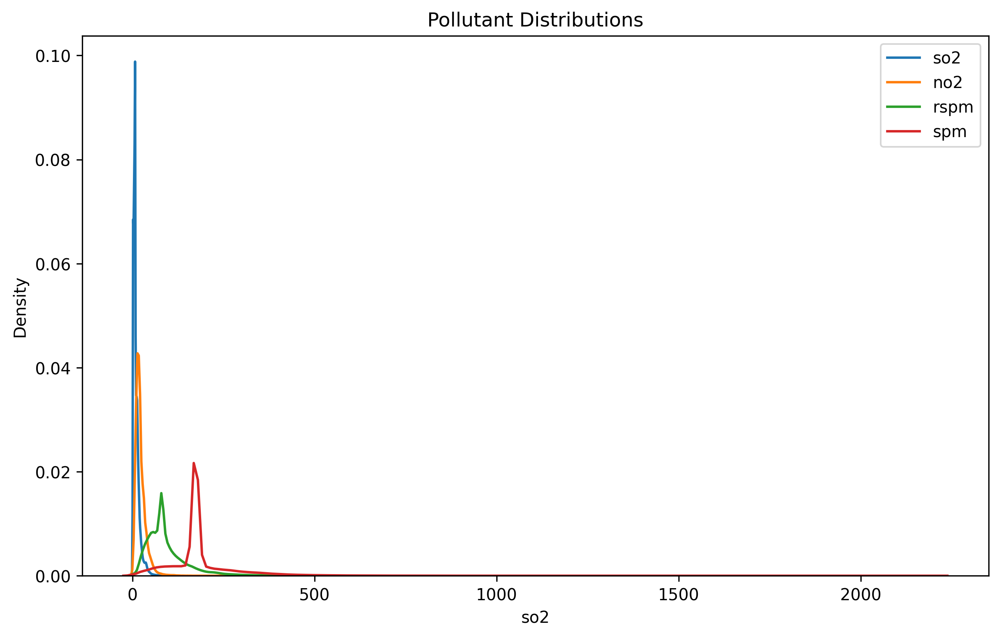
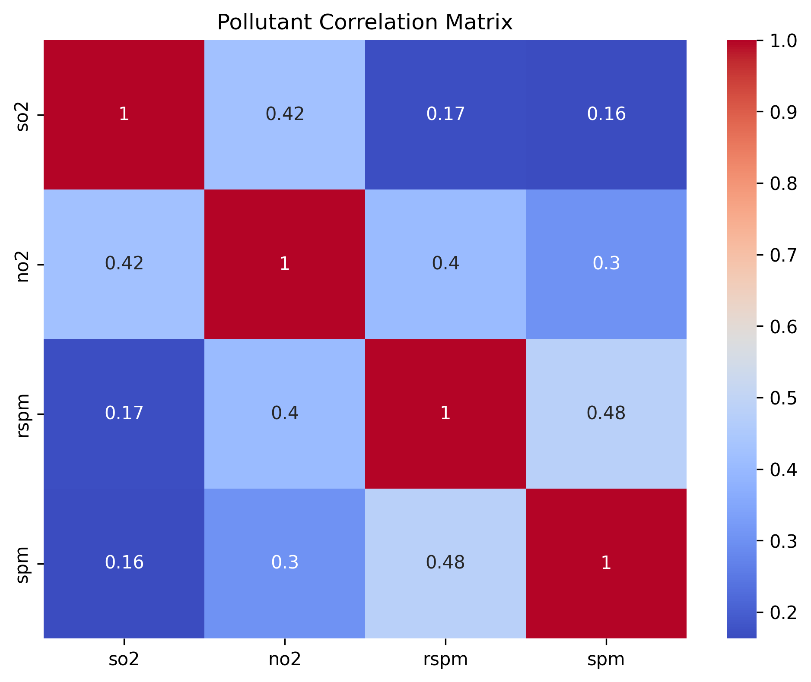
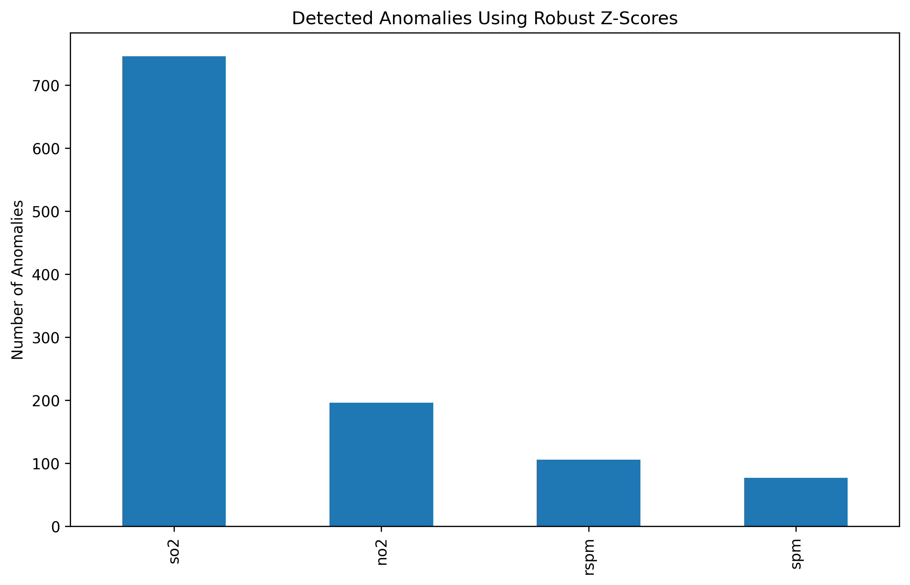
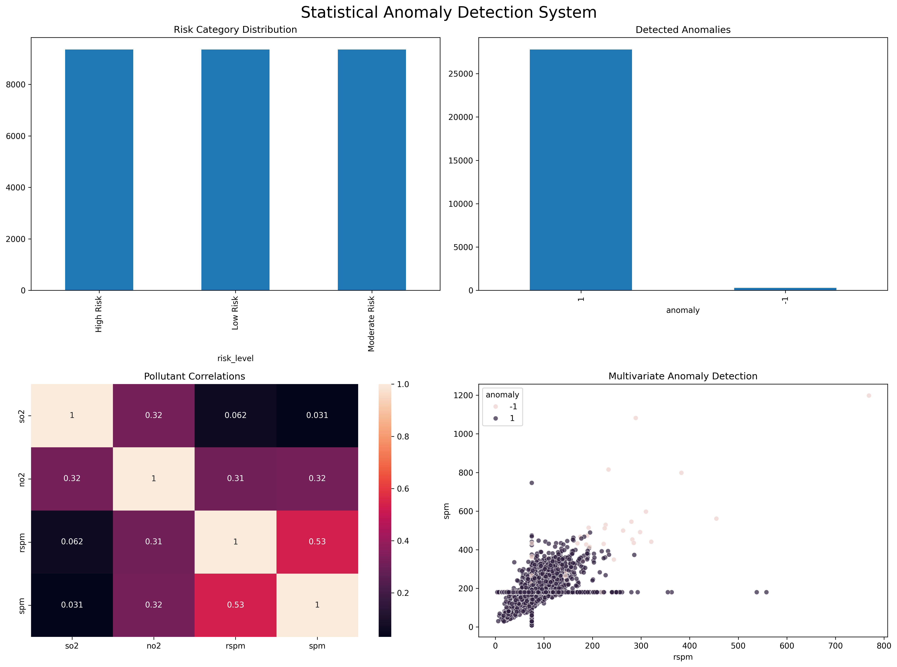

# Statistical Anomaly Detection System

---

## Executive Summary

The Statistical Anomaly Detection System is a computational statistics project that investigates unusual patterns in environmental pollution measurements using robust statistical methods and unsupervised machine learning.

The project uses the Air Quality Data in India dataset, containing 260,621 observations collected across multiple monitoring locations and periods. It combines exploratory data analysis, robust descriptive statistics, Median Absolute Deviation (MAD)-based Z-scores, and Isolation Forest to examine extreme pollutant concentrations and identify observations with unusual multivariate profiles.

The analysis also translates model-generated anomaly scores into relative categories to demonstrate how statistical outputs can be organized for environmental monitoring and further investigation.

The project illustrates the application of computational statistics and statistical learning to large-scale environmental data, while highlighting important considerations involving missing observations, extreme values, and the interpretation of unsupervised anomaly detection results.

---

## Research Question

Can robust statistical methods and multivariate machine learning identify unusual pollution patterns in large-scale environmental monitoring data?

---

## Dataset

The project uses the **Air Quality Data in India** dataset, which contains historical air quality measurements from monitoring stations across different states and locations in India.

### Dataset Characteristics

- 260,621 observations
- 13 original variables
- Multiple environmental monitoring locations
- Historical pollutant concentration measurements
- Sampling dates and monitoring information

### Key Variables

| Variable | Description |
|---|---|
| SO₂ | Sulfur dioxide concentration |
| NO₂ | Nitrogen dioxide concentration |
| RSPM | Respirable Suspended Particulate Matter |
| SPM | Suspended Particulate Matter |

**Variable selection:** PM2.5 was excluded from the main analysis because only 5,078 of the 260,621 observations contained non-missing measurements. The subsequent analysis focused on SO₂, NO₂, RSPM, and SPM.

---

## Project Objectives

- Examine the distributional characteristics of environmental pollution measurements.
- Investigate relationships among pollutant concentrations.
- Compare classical and robust descriptive statistics.
- Identify extreme observations using robust Z-scores.
- Apply multivariate anomaly detection using Isolation Forest.
- Organize anomaly scores into interpretable relative categories.
- Develop visual summaries to communicate the analytical results.

---

## Methodology

### Phase 1 — Data Collection and Preprocessing

The original dataset was loaded and examined to understand its structure, variable types, and data quality.

Key procedures included:

- Dataset loading and structural inspection.
- Assessment of missing observations.
- Selection of four pollutant concentration variables.
- Exclusion of PM2.5 because of limited observational coverage.
- Median imputation for missing values in the selected pollutant variables.

Median imputation was used to reduce the influence of extreme observations on the imputation values.

### Phase 2 — Exploratory Data Analysis

Exploratory analysis was conducted to examine the distributional and relational characteristics of the selected pollutants.

The analysis included:

- Descriptive statistical summaries.
- Kernel density distribution plots.
- Correlation matrix analysis.
- Pollutant boxplots.
- Annual average RSPM trend visualization.

The correlation analysis provided an initial assessment of the relationships among pollutant measurements and helped motivate the use of multivariate analytical methods.

### Phase 3 — Robust Statistical Analysis

Robust statistical techniques were applied to examine the influence of extreme observations and characterize pollutant variability.

The analysis compared:

- Arithmetic mean and median.
- Standard deviation and Median Absolute Deviation (MAD).
- Classical and robust measures of dispersion.

Robust Z-scores were calculated using:

\[
Z_{\text{robust}} =
\frac{0.6745(x-\text{Median})}{MAD}
\]

An observation was flagged as an extreme value when:

\[
|Z_{\text{robust}}| > 3.5
\]

This procedure was applied separately to each pollutant variable.

### Phase 4 — Multivariate Anomaly Detection

Isolation Forest was implemented using Scikit-learn to examine unusual combinations of pollutant measurements.

Model configuration:

- Algorithm: Isolation Forest
- Contamination parameter: 0.01
- Random state: 42
- Input variables: SO₂, NO₂, RSPM, and SPM

The model generated binary anomaly classifications and continuous anomaly scores.

In the Scikit-learn implementation, observations classified as `-1` are identified as anomalies, while observations classified as `1` are treated as normal.

The decision function provides a relative measure of how unusual an observation is: lower scores indicate more anomalous observations.

### Phase 5 — Relative Anomaly-Score Categorization

The anomaly scores were divided into three approximately equal-frequency groups using quantile-based discretization (`pandas.qcut`).

The resulting categories were:

- High Risk
- Moderate Risk
- Low Risk

These labels represent relative positions in the anomaly-score distribution. They are not absolute pollution severity thresholds, regulatory classifications, or validated public-health risk levels.

The categorized observations were used to generate summary outputs and visualizations for further investigation.

### Phase 6 — Visualization and Dashboard Development

A consolidated dashboard was developed to communicate the principal analytical outputs.

It integrates:

- Relative anomaly-score categories.
- Isolation Forest classifications.
- Pollutant correlation structure.
- Multivariate scatter visualization.

The dashboard provides a visual summary of the analysis rather than an independently validated environmental warning system.

---

## Key Findings

### 1. Pollutant Distribution Behavior

The exploratory analysis revealed substantial variation in pollutant concentrations, with distributions exhibiting skewness and extreme observations.

The observed distributional characteristics support the use of robust descriptive measures and motivate further investigation of unusual pollutant values.

### 2. Correlation Structure

The correlation analysis identified positive associations among the selected pollutant variables.

| Variable Pair | Correlation |
|---|---:|
| SO₂ – NO₂ | 0.423 |
| NO₂ – RSPM | 0.403 |
| RSPM – SPM | 0.480 |

The strongest of these reported associations was between RSPM and SPM, followed by SO₂ and NO₂.

These relationships provide evidence of dependence among pollutant measurements and support examining observations across multiple variables rather than relying exclusively on individual pollutant thresholds.

### 3. Robust Statistical Analysis

The comparison of classical and robust descriptive statistics produced the following results:

| Variable | Mean | Median | Standard Deviation | MAD |
|---|---:|---:|---:|---:|
| SO₂ | 7.73 | 5.50 | 6.08 | 1.50 |
| NO₂ | 27.33 | 29.00 | 13.36 | 5.70 |
| RSPM | 83.17 | 84.00 | 31.04 | 16.00 |
| SPM | 197.30 | 181.00 | 86.44 | 51.00 |

The differences between the means and medians, particularly for SO₂ and SPM, illustrate why distribution-sensitive interpretation is important when analyzing environmental measurements.

Using an absolute robust Z-score threshold greater than 3.5, the analysis identified:

| Pollutant | Extreme Observations |
|---|---:|
| SO₂ | 746 |
| NO₂ | 196 |
| RSPM | 106 |
| SPM | 77 |

SO₂ had the highest number of observations exceeding the selected robust Z-score threshold.

These are univariate statistical flags. They should not automatically be interpreted as confirmed pollution incidents.

### 4. Multivariate Anomaly Detection

Isolation Forest was applied to the four selected pollutant variables to identify observations with unusual multivariate profiles.

The final dashboard notebook (Notebook 06) reports the following classification counts:

| Classification | Count |
|---|---:|
| Normal Observations | 27,789 |
| Anomalous Observations | 281 |
| **Total** | **28,070** |

The reported anomaly count represents approximately 1% of the observations in that notebook's output, consistent with the model's specified contamination parameter.

Unlike the individual robust Z-score procedures, Isolation Forest considers the pollutant variables jointly when identifying unusual observations.

**Reproducibility note:** The anomaly detection notebooks report different observation totals. Notebook 04 reports 9,202 observations, while Notebook 06 reports 28,070. The displayed code does not establish why these sample sizes differ. The figures above are therefore presented as the reported Notebook 06 output, not as a reconciled result for the entire original dataset.

### 5. Relative Anomaly-Score Categories

The anomaly scores were divided into three approximately equal-frequency groups.

The final dashboard notebook reports:

| Category | Count |
|---|---:|
| High Risk | 9,357 |
| Moderate Risk | 9,356 |
| Low Risk | 9,357 |
| **Total** | **28,070** |

The High Risk category corresponds to the lower end of the Isolation Forest decision-score distribution, where observations are relatively more anomalous.

These categories are relative statistical groupings. They should not be interpreted as evidence that an observation violates an air quality standard or poses a specific level of health risk.

---

## Research Insights

The analysis demonstrates several important statistical considerations:

- Environmental pollutant measurements can exhibit substantial variation and extreme values.
- Mean and median comparisons, together with MAD, provide complementary information about pollutant distributions.
- Robust Z-scores provide a univariate approach to screening extreme pollutant measurements.
- Isolation Forest provides a multivariate approach that considers combinations of pollutant variables.
- Quantile-based categorization can simplify the interpretation of anomaly scores, although the resulting categories depend on the observed score distribution.

An important distinction in this project is that an observation flagged by a statistical or machine learning procedure is an unusual observation, not necessarily a confirmed environmental incident.

---

## Practical Relevance

The analytical framework illustrates techniques that may contribute to:

- Environmental monitoring and exploratory surveillance.
- Screening unusual pollutant measurements for further investigation.
- Identifying potentially unusual combinations of pollutant concentrations.
- Organizing monitoring observations for analytical review.
- Supporting the development of more comprehensive environmental anomaly detection systems.

The current implementation is an analytical prototype. Operational deployment would require additional validation, monitoring context, and integration with environmental standards.

---

## Project Dashboard

The dashboard consolidates the principal analytical outputs into a single visualization.

It includes:

- Relative anomaly-score category distribution.
- Isolation Forest anomaly classifications.
- Pollutant correlation heatmap.
- Multivariate scatter analysis.

The dashboard provides a concise overview of the project's statistical and machine learning results.

---

## Limitations

Several limitations should be considered when interpreting the findings:

- **Missing observations:** PM2.5 was excluded because of its limited data coverage. Median imputation for the remaining pollutants may also affect the distribution and anomaly structure.
- **Observation consistency:** The displayed notebook outputs contain different observation totals across analytical stages. The source of these differences requires further investigation.
- **Unsupervised evaluation:** The dataset does not provide confirmed anomaly labels in the implemented analysis. Consequently, classification accuracy, precision, recall, and detection sensitivity were not established.
- **Contamination parameter:** The Isolation Forest contamination setting influences the proportion of observations classified as anomalous.
- **Relative risk categories:** Quantile-based groups are dependent on the score distribution and do not represent absolute environmental or public-health risk thresholds.
- **Temporal dependence:** Although annual RSPM averages were visualized, the project did not implement a formal time-series anomaly detection model.
- **Spatial structure:** Differences among monitoring stations and geographic locations were not explicitly modeled.
- **Imputation effects:** Replacing missing values with medians may reduce variability and affect the identification of unusual multivariate patterns.

---

## Technologies

- Python
- Pandas
- NumPy
- SciPy
- Matplotlib
- Seaborn
- Scikit-learn
- Jupyter Notebook

---

## Statistical Techniques

- Exploratory Data Analysis
- Descriptive Statistics
- Correlation Analysis
- Median Absolute Deviation (MAD)
- Robust Z-score Analysis
- Unsupervised Machine Learning
- Isolation Forest
- Anomaly Score Analysis
- Quantile-based Categorization
- Environmental Data Visualization

---

## Skills Demonstrated

- Computational Statistics
- Robust Statistical Analysis
- Statistical Learning
- Unsupervised Machine Learning
- Multivariate Data Analysis
- Environmental Data Science
- Data Preprocessing
- Statistical Visualization
- Analytical Reporting

---

## Future Work

Potential extensions include:

- Bayesian approaches to anomaly detection and uncertainty quantification.
- Extreme Value Theory for modeling extreme pollutant concentrations.
- Spatial statistical modeling to account for geographic variation.
- Time-series anomaly detection to investigate temporal pollution patterns.
- Improved missing-data strategies and sensitivity analysis.
- Validation against regulatory air quality thresholds and independently verified pollution events.
- Streaming data pipelines for continuous environmental monitoring.
- Interactive dashboard deployment using Plotly, Dash, or Streamlit.

---

## References

1. Huber, P. J. *Robust Statistics*.
2. Hastie, T., Tibshirani, R., and Friedman, J. *The Elements of Statistical Learning*.
3. James, G., Witten, D., Hastie, T., and Tibshirani, R. *An Introduction to Statistical Learning*.
4. Scikit-learn Documentation - Isolation Forest.
5. Air Quality Data in India Dataset.

---
