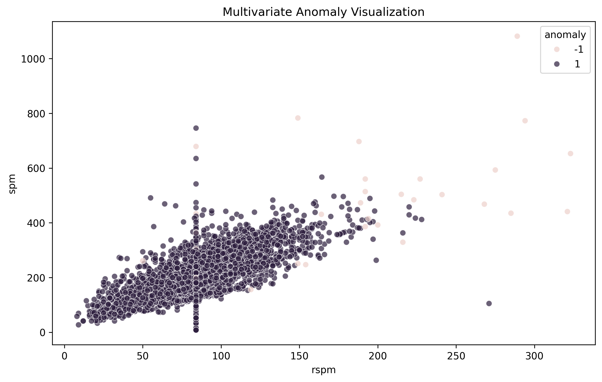
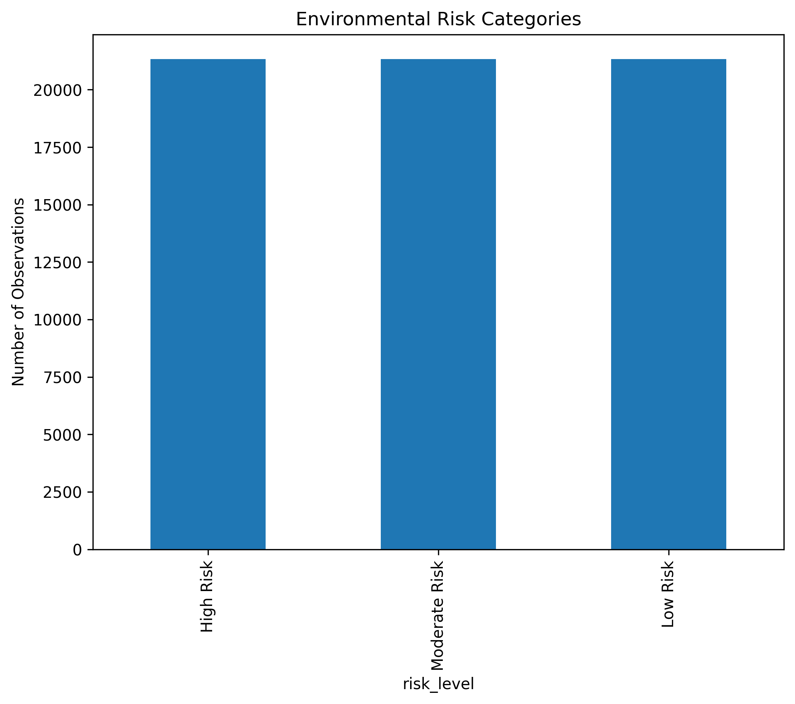

# Statistical Anomaly Detection System



---

## Executive Summary

The Statistical Anomaly Detection System is a computational statistics project designed to identify unusual environmental pollution patterns using robust statistical methods and multivariate machine learning techniques.

Using a large-scale Air Quality dataset from India containing over 260,000 observations, the project integrates exploratory data analysis, robust statistical modeling, and Isolation Forest–based anomaly detection to identify abnormal pollution events that may warrant further investigation.

This framework demonstrates how computational statistics, robust inference methods, and statistical learning techniques can support environmental monitoring, risk assessment, and data-driven decision-making in high-dimensional environmental systems.

---

## Research Question

Can robust statistical methods and multivariate machine learning models identify anomalous pollution patterns in large-scale environmental monitoring data?

---

## Dataset

The project uses the **Air Quality Data in India** dataset containing environmental monitoring records across multiple states, locations, and time periods.

### Dataset Characteristics

* 260,621 observations
* Multi-location air quality monitoring stations
* Longitudinal environmental measurements
* Pollutant concentration variables

### Key Variables

| Variable | Description                             |
| -------- | --------------------------------------- |
| SO₂      | Sulfur Dioxide Concentration            |
| NO₂      | Nitrogen Dioxide Concentration          |
| RSPM     | Respirable Suspended Particulate Matter |
| SPM      | Suspended Particulate Matter            |

> **Note:** PM2.5 was excluded due to extremely high missingness and insufficient coverage for reliable statistical inference.

---

## Project Objectives

* Analyze large-scale environmental pollution data
* Examine pollutant distributions and relationships
* Detect extreme observations using robust statistical methods
* Identify multivariate anomalies using machine learning
* Develop environmental risk categorization framework
* Generate interpretable anomaly-based alerts

---

## Methodology

### Phase 1 — Data Collection and Preprocessing

* Dataset loading and inspection
* Missing value assessment
* Median imputation for selected pollutants
* Exclusion of high-missingness variables (PM2.5)

---

### Phase 2 — Exploratory Data Analysis

* Distribution analysis of pollutants
* Correlation structure examination
* Outlier visualization using boxplots
* Temporal trend analysis (RSPM over time)

---

### Phase 3 — Robust Statistical Analysis

To reduce sensitivity to extreme observations:

* Median-based central tendency
* Median Absolute Deviation (MAD)
* Robust Z-score computation

This approach provides more stable inference under heavy-tailed distributions.

---

### Phase 4 — Multivariate Anomaly Detection

An **Isolation Forest** model was applied for multivariate anomaly detection.

* Contamination parameter: **1%**
* Uses decision function scoring
* Captures nonlinear multivariate relationships

> Lower anomaly scores indicate more unusual observations.

---

### Phase 5 — Environmental Risk Categorization

Anomaly scores were converted into interpretable risk categories using quantile-based discretization:

* High Risk
* Moderate Risk
* Low Risk

---

# Key Findings

---

## 1. Pollutant Distribution Behavior


Pollutants exhibit:

* Strong right-skewed distributions
* Heavy-tailed behavior
* Presence of extreme values

These characteristics motivate the use of robust statistical techniques rather than mean-based inference.

---

## 2. Correlation Structure


Moderate positive relationships exist among pollutants:

| Variable Pair | Correlation |
| ------------- | ----------: |
| SO₂ – NO₂     |       0.423 |
| NO₂ – RSPM    |       0.403 |
| RSPM – SPM    |       0.480 |

These dependencies justify multivariate anomaly detection methods.

---

## 3. Robust Statistical Analysis


Robust Z-score analysis identified extreme observations:

| Pollutant | Anomalies |
| --------- | --------: |
| SO₂       |       746 |
| NO₂       |       196 |
| RSPM      |       106 |
| SPM       |        77 |

### Summary Statistics

| Variable | Mean   | Median |
| -------- | ------ | ------ |
| SO₂      | 7.73   | 5.50   |
| NO₂      | 27.33  | 29.00  |
| RSPM     | 83.17  | 84.00  |
| SPM      | 197.30 | 181.00 |

Large mean–median gaps confirm skewness and outlier influence.

---

## 4. Multivariate Anomaly Detection


Isolation Forest results (final evaluation):

| Classification         |  Count |
| ---------------------- | -----: |
| Normal Observations    | 27,789 |
| Anomalous Observations |    281 |

Approximately 1% of observations were classified as anomalies.

Unlike univariate methods, this model captures **joint abnormal behavior across multiple pollutants**.

---

## 5. Environmental Risk Categorization



Risk categories were generated using quantile binning:

| Risk Level    |   Count |
| ------------- | ------: |
| High Risk     | ~21,340 |
| Moderate Risk | ~21,340 |
| Low Risk      | ~21,340 |

> Risk groups are equal-frequency bins derived from anomaly score distribution, not absolute severity thresholds.

---

## Research Insight

The results demonstrate that:

* Robust statistical methods successfully identify extreme pollutant behavior
* Multivariate models detect anomalies missed by univariate approaches
* Isolation Forest effectively captures nonlinear environmental interactions
* Air quality data exhibits strong skewness and heavy-tailed structure

---

## Practical Implications

This framework can support:

* Environmental monitoring systems
* Air quality surveillance programs
* Public health risk assessment
* Regulatory compliance tracking
* Early warning systems for pollution spikes

---

## Project Dashboard


The dashboard integrates:

* Risk categorization
* Anomaly detection results
* Correlation structure
* Multivariate scatter analysis

It provides a unified statistical summary of environmental conditions.

---

## Limitations

* PM2.5 excluded due to excessive missing values
* Median imputation may reduce sensitivity to extreme events
* Isolation Forest results depend on contamination parameter selection
* Temporal dependency modeling was not explicitly performed
* Spatial variability across monitoring stations was not modeled

---

## Technologies

* Python
* Pandas
* NumPy
* SciPy
* Matplotlib
* Seaborn
* Scikit-learn
* Jupyter Notebook

---

## Statistical Techniques

* Exploratory Data Analysis (EDA)
* Correlation Analysis
* Robust Statistics (MAD, median-based inference)
* Robust Z-score Analysis
* Multivariate Anomaly Detection
* Isolation Forest
* Quantile-based Risk Modeling

---

## Skills Demonstrated

* Computational Statistics
* Statistical Learning
* Robust Data Analysis
* Environmental Data Science
* Machine Learning (Unsupervised Learning)
* Data Visualization
* Risk Modeling

---

## Repository Structure

```text
statistical-anomaly-detection-system/
│
├── data/
├── images/
├── notebooks/
│   ├── 01_data_collection.ipynb
│   ├── 02_exploratory_analysis.ipynb
│   ├── 03_robust_statistics.ipynb
│   ├── 04_multivariate_anomaly_detection.ipynb
│   ├── 05_alert_generation_system.ipynb
│   └── 06_model_evaluation_and_dashboard.ipynb
│
├── README.md
├── requirements.txt
└── LICENSE
```

---

## Future Work

* Bayesian anomaly detection models
* Real-time environmental monitoring pipeline
* Spatial statistical modeling of pollution
* Extreme value theory (EVT) integration
* Streaming data anomaly detection systems
* Interactive dashboard deployment (Plotly/Dash or Streamlit)

---

## References

1. Hastie, Tibshirani, Friedman — *The Elements of Statistical Learning*
2. James et al. — *An Introduction to Statistical Learning*
3. Huber, P.J. — *Robust Statistics*
4. Scikit-learn Documentation
5. Air Quality Data in India Dataset

---

## Author

**Clement Kofi Okyere Biew**

Computational Statistics | Data Science | Statistical Learning | Machine Learning | Environmental Analytics
